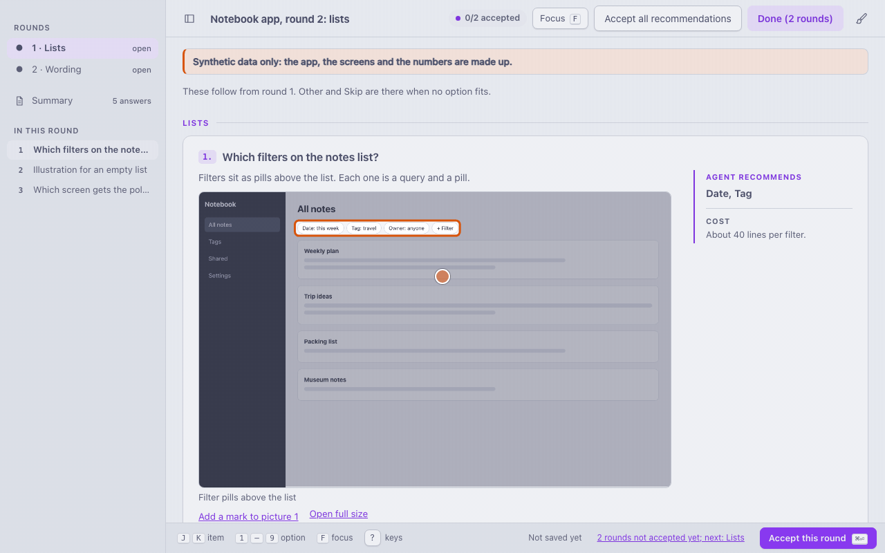

# Signoff

**Stop answering your coding agent in a wall of terminal text. Signoff puts its decisions on one page, with
mockups, costs and its pick preselected, and gathers every project's questions in one inbox. Accept the pick
from a notification and the agent carries on. Nothing leaves your machine.**

(A notification answer needs the optional macOS app; it ships as source, to build yourself.)

[](https://github.com/lumi-collective/signoff/actions/workflows/test.yml)
[](LICENSE)



Signoff is a Claude Code plugin: a small Python server, one static page, and a skill that teaches the agent
when and how to use them. The agent writes a JSON file of decisions for each round of questions. Signoff serves
them on `127.0.0.1`, the rounds in a sidebar, and opens your browser. Every click and comment is saved as you go.
You accept each round, check the Summary, and press **Done**: Signoff exits and prints the paths of the answers
files, and the agent, which ran it in the background, wakes up and reads them. Rounds you answered earlier stay
on the page, read only.

To look back at what you said, `--history` opens every round of a project in one read-only list (see
[Past decisions](docs/history.md#past-decisions)).

## Who it's for

You let an agent do a design pass, a cleanup or a migration plan, and it comes back with a dozen questions.
In the terminal that is a wall of text, or several rounds of four questions at a time, and some of them only
make sense next to a screenshot. Signoff puts them on one page, each with its picture, its cost and the agent's
recommendation, so you can go through them in a few minutes and leave a comment where a choice is not enough.

A quick go or skip that blocks the agent's next step stays Claude Code's own question prompt in the terminal; the
skill tells the agent so.

## How it works


1. The agent writes `round-01.json` (and more rounds, if they do not depend on each other) into a folder for
   the topic, with the pictures beside it.
2. It starts `signoff.py` on that folder in the background. Signoff opens your browser with a link that works
   once.
3. You answer. Everything is saved to `round-NN.answers.json` as you go.
4. You accept each round and press **Done**. Signoff exits, printing one answers path per line; that exit is what
   wakes the agent.
5. The agent reads the answers, does the work, and records what came of each round.

In the clip above, a small script stands in for the person at the browser (`media/demo/answer.py`): the terminal
has no browser. It sends the same requests the page does.

## Requirements

- **Claude Code on your own computer.** Signoff starts a local server and opens your browser on the machine
  Claude Code runs on, so it works only in Claude Code there: not on claude.ai on the web or on mobile, and not
  in Cowork.
- **Claude Code**: CI validates the plugin with a pinned version, 2.1.309 at the time of writing.
- **Python 3.9 or newer** as `python3` (macOS, Linux) or through the `py` launcher (Windows). Standard library
  only; nothing else to install. To get it:
  - Windows: the Python install manager from [python.org](https://www.python.org/downloads/) (or
    `winget install 9NQ7512CXL7T -e`), which brings the `py` command.
  - macOS: `xcode-select --install` (the Command Line Tools bring Python 3.9), or the installer from python.org.
    If macOS offers to install the Command Line Tools when Signoff first runs, that is this step.
  - Linux: your distribution's `python3` package.
- **A web browser** on the same machine. Over SSH, see `--no-open` under [Running it yourself](docs/running.md#running-it-yourself).

## Where it works

| | Status |
|---|---|
| Terminal (`claude`) on macOS | Tested. |
| Windows | Tried in a real Claude Code session: the page opened in Chrome and the answer reached the session. The test suite and the browser check also run in CI. |
| Linux | The test suite runs in CI, with Python 3.9 and 3.13. A browser check runs there too: the server and the page in headless Chrome, with real mouse clicks, from the start link to Done (see [Development and tests](docs/development.md#development-and-tests)). Not tried in a real Claude Code session yet. |
| Desktop app, VS Code extension | Untested. |
| claude.ai (web, mobile) and Cowork | Not supported: the plugin does not install there. |
| Chrome | Tested, headless, driven over the DevTools protocol. |
| Firefox, Safari | Untested. |
| Other agents (Codex, Cursor, Cline) | Through the experimental [MCP server](docs/mcp.md#other-agents-the-mcp-server); the config snippets are untested. |

## Install, update, uninstall

At the prompt of a terminal session:

```
/plugin install signoff --marketplace lumi-collective/signoff
```

From a shell:

```
claude plugin install signoff --marketplace lumi-collective/signoff
```

In the desktop app: + next to the prompt box → Plugins → Add marketplace `lumi-collective/signoff` → Add plugin.

Then the status line shows one monitor: a small process that only sleeps until you use the
[Signoff inbox](#the-inbox).

Update: `claude plugin update signoff@signoff`, then `/reload-plugins`.
Uninstall: `claude plugin uninstall signoff@signoff`. Decision folders and answers files in your projects stay
where they are.

## Quick start

**Try the page** from a clone of this repository:

```
python3 -I plugin/signoff/signoff.py examples/demo
```

Four rounds of a synthetic settings redesign open, listed in the sidebar. Your answers go to `examples/demo/*.answers.json`,
which git ignores. Run it again and the page resumes from them; a round you finished with Done stays read only,
and once every round is done Signoff says so and exits.

**With an agent** there is nothing to set up. When it has a decision for you, or a task that waits on you, the
`signoff` skill tells it to:

1. make a topic folder, `.signoff/<YYYY-MM-DD>-<slug>/` in the project, or under the folder you set as the
   plugin's Decisions folder option in `/config`, relative to the project root or absolute;
2. write the round there, at most three open rounds and about twelve items each;
3. run `python3 -I "${CLAUDE_PLUGIN_ROOT}/signoff/signoff.py" "<folder>"` in the background, from the main
   session (a background command started by a subagent ends with it);
4. read every line of stdout when it exits, act on the answers, and record the outcome.

You can also ask for it directly: "put these on a Signoff page".

**Look back** at earlier decisions of a project, from a clone of this repository:

```
python3 -I plugin/signoff/signoff.py --history <project root>
```

Ask the agent "what did we decide before?" and it opens the same page. See [Past decisions](docs/history.md#past-decisions).

## The inbox

The inbox is one browser tab for every project. It lists the open rounds of runs that wait in the background, the
todo items an agent marked as waiting on you, and the Claude Code sessions that wait on you for a permission or an
answer. When [Uptick](https://github.com/lumi-collective/uptick) keeps its vulnerability scan file, it also shows
each project's known vulnerabilities. Ask the agent to open the Signoff inbox. A round opens on the usual page in
the same tab; Done there writes the answers file, and the waiting run wakes its agent. On an open todo item you can
send a message to the project's agent. The inbox listens on `127.0.0.1` with the same rules as a run, never runs a
command from a todo file, and does not run on Windows yet. Everything about it is in
[docs/inbox.md](docs/inbox.md).

While the inbox runs, each Claude Code session shows above its prompt how much waits on you in its own project:
`Signoff: 2 waiting`, with **Open** and **Hide**. **Open**, or `/signoff:open`, lists the project's open rounds and
their questions in a panel beside the chat. A row opens that question in the browser. With the macOS app
installed, its **App** button opens it in the app. The `hint` setting in `/config` moves the number to the status
line or turns it off. This needs a Claude Code that runs plugin mods; an older one skips it.

## The macOS app

`app/` builds Signoff, an optional macOS app around the inbox. It is not part of the plugin. It shows the inbox in
its own window and in a menu bar panel, the number waiting on you as a Dock badge, and a notification when that
number goes up, which can answer a single question. Install it with Homebrew, which builds it on your Mac from this
release's source and puts it in `/Applications` (a Signoff.app you copied there by hand: remove it first):

```bash
brew tap lumi-collective/signoff
brew trust --cask lumi-collective/signoff/signoff
brew install --cask lumi-collective/signoff/signoff
```

Homebrew 7 loads a cask from a tap outside its own only once you trust it, hence `brew trust`. It needs the Xcode
Command Line Tools; Homebrew brings Go. Then start a Claude Code session with the plugin once, so
the app can find it. Other ways to build it, and the details: [docs/inbox.md](docs/inbox.md#the-macos-app).

## What runs, and what leaves your machine

- **Runs:** one Python process for as long as the page is open, and your browser. The plugin's hooks and its
  monitor run in every Claude Code session; until the inbox has run, they only look for `inbox.lock`, and while
  no inbox runs, only a session's start does more than look at that file's time (on macOS
  with the Signoff app installed, a new session's start also keeps a link to the plugin's command for the app). The hooks
  always exit 0 and print nothing, so they never block or change a session; the one exception is the hand-over of
  messages from the inbox at a session's start. In an interactive session of a Claude Code that runs plugin mods,
  the plugin's mod also shows above the prompt how many rows of Waiting on you belong to that project. The rows are
  open rounds, waiting todo items and its sessions waiting on a permission or an answer, this one included. The mod
  reads the count from the inbox's `state.json` every five seconds while an inbox lives, with no process for that.
  `/signoff:open` and its Open button list the project's open rounds in a panel (`signoff inbox rows`, once per
  opening). Each row runs `signoff inbox open` for its question. With the macOS app installed, an App button beside
  it runs `signoff inbox open --app`, which runs `open -a` with the path of the app copy it checked. The `hint`
  setting moves the count to the status line or turns it off. The inbox and the macOS app are extra processes only
  when you start them.
- **Leaves your machine:** nothing from Signoff. The server listens on `127.0.0.1` only, the page loads nothing
  from outside, and there is no telemetry and no update check. A board's own script could still send data out over
  WebRTC, so boards hold synthetic data only.
- **Written to disk:** the answers files, their Markdown copies and, when the folder has none, a `.gitignore`;
  once the inbox has run, also locks, run notes, the hooks' notes of projects and sessions (no prompt or message)
  and the inbox's own files, all in the Signoff home; outside it, only on your click, Uptick's list of projects to
  scan. Nothing is deleted, with two narrow exceptions.

The full list: [docs/security.md](docs/security.md#what-runs-and-what-leaves-your-machine).

## Security

Signoff is a web server on your machine that writes files, and any other web page open in the same browser can
send requests to `127.0.0.1`. In short:

- It binds `127.0.0.1` on a port the OS picks, with a random token in every path and an exact `Host` check. No
  cookies.
- The browser opens a single-use start link; a second use gets 410 and stops the run.
- A save needs `application/json`, the page's own `Origin`, and a body within its size limit; a stale save gets 409.
- Only listed files are served, each inside the round's folder; no SVG, no directory listing.
- Agent text is text: a strict Content-Security-Policy, no inline styles or handlers.
- Boards run sandboxed, with a token of their own.

The rules in full: [docs/security.md](docs/security.md#security-model). The scope and how to report a vulnerability:
[SECURITY.md](SECURITY.md).

## Limits

- The page's own labels are in English and Hungarian; your text is plain, with no Markdown, links or HTML.
- Attachments: up to 256 KiB each, 20 an item and 200 a round.
- Pictures, boards and attachments are read at start; changing a round's files while the page is open needs a
  restart.
- Marks are rectangles on pictures, not on boards.

All of them: [docs/limits.md](docs/limits.md).

## Documentation

- [On the page](docs/page.md): what the page shows, marks, boards, keys, palettes.
- [Past decisions](docs/history.md): the read-only list of every round of a project.
- [The decisions file](docs/decisions-file.md): the JSON an agent writes, with the table of keys.
- [The answers file](docs/answers-file.md): what comes back, and keeping answers out of git.
- [Running it yourself](docs/running.md): options, exit codes and the Signoff home.
- [The inbox and the macOS app](docs/inbox.md): the inbox in full, and how to build the app.
- [What runs, and the security model](docs/security.md): processes, files written, and the rules in full.
- [Other agents: the MCP server](docs/mcp.md): Codex, Cursor and Cline; experimental.
- [Troubleshooting](docs/troubleshooting.md): messages and what to do about them.
- [Limits](docs/limits.md): sizes and what Signoff does not do.
- [Development and customizing](docs/development.md): tests, how the media is made, forking it with Claude.

## Contributing, security, changes

Issues and pull requests are welcome; read [AGENTS.md](AGENTS.md) first, and keep each change small and
tested. Report a vulnerability privately: see [SECURITY.md](SECURITY.md). Changes: [CHANGELOG.md](CHANGELOG.md).

## Acknowledgements

Signoff copies no code, but it borrows these patterns:

- **GOV.UK Frontend** (MIT): radio buttons and checkboxes as native inputs in a `fieldset` with a `legend` and a
  `label` for each. GOV.UK advises against preselecting an option; Signoff does preselect the recommendation,
  so it labels it visibly.
- **SurveyJS Form Library** (MIT): the key names `description`, `choices` (here `options`), `defaultValue`
  (here `recommended`) and `showCommentArea` (here `comment`).
- **W3C Media Fragments URI 1.0** (a W3C Recommendation): the meaning of `xywh=percent:x,y,w,h`, which the
  `boxes` follow.

## License

[MIT](LICENSE)
