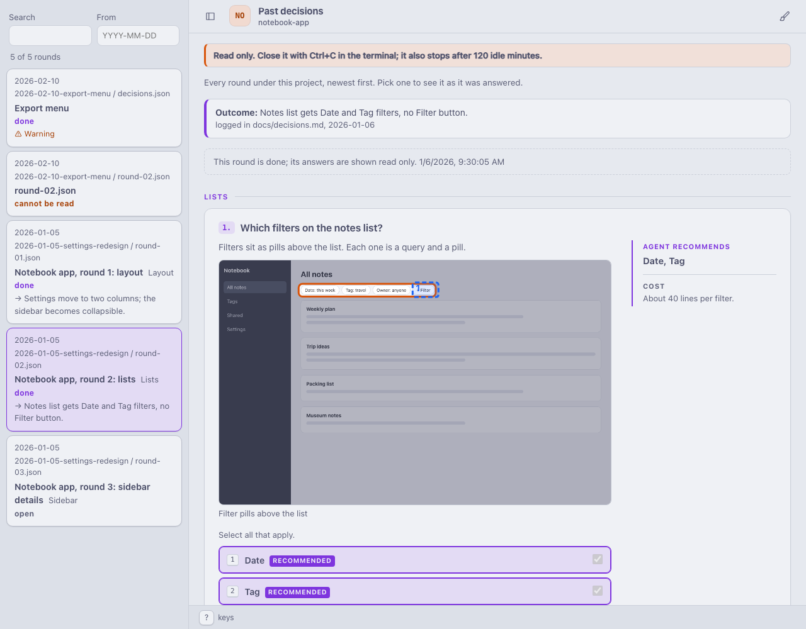

# Past decisions

```
python3 -I plugin/signoff/signoff.py --history <project root> [--folder <decisions folder>] [--since YYYY-MM-DD]
```

A read-only page of every round under the project, newest first: the rounds in `.signoff/*/`, or in the folder
`--folder` names, with date, title, tab and status (done, open, not answered, or a file that cannot be read).
Filter by text or from a date, and open a round to see it as it was answered, marks included. The text
search also covers your answers (chosen options, comments, Other text, mark comments, free text), never the text
of a Private answer. A round whose
decisions changed after it was answered carries a warning; a missing picture shows a placeholder; a broken file
is listed with its error. Pictures are read when you open a round, up to 200 MiB for the whole list; past that,
narrow it with `--since`. The rounds' own text (decisions, answers, outcome) takes up to 32 MiB of the page,
counted as sent, where `<`, `>` and `&` take 6 bytes each; the newest topics come first, and a round past that is
listed with an error that says to narrow the list.

When the agent has acted on a round, it writes what came of it beside the round, as `<round>.outcome.json`, and
the page shows that line with the round:

```json
{"log": "docs/decisions.md", "line": "Settings move to two columns.", "date": "2026-01-05"}
```

Nothing on this page can be changed and nothing is written: it has no save route and no Done. Close it with
Ctrl+C; it also stops after the idle timeout.


