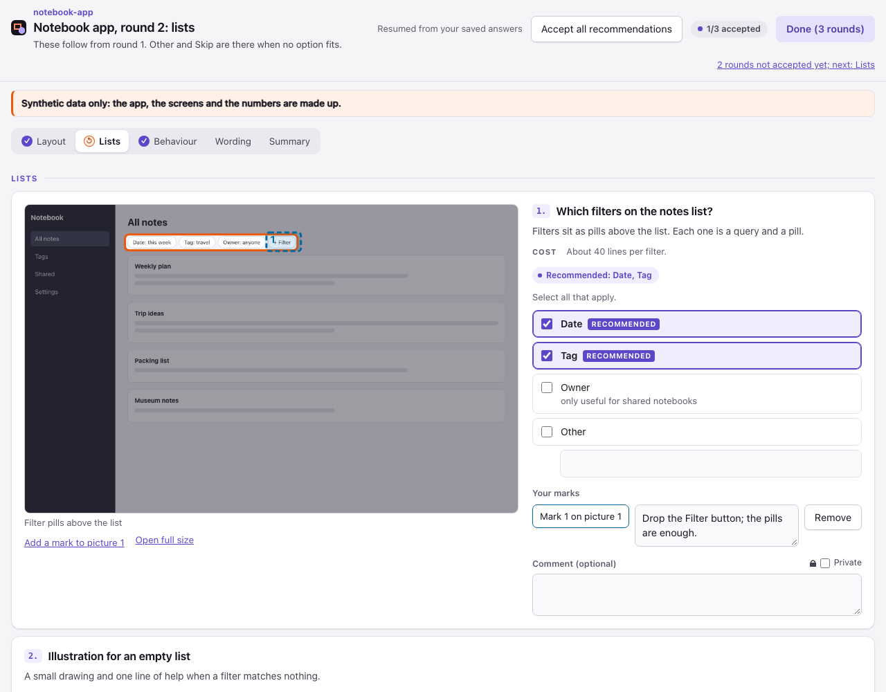
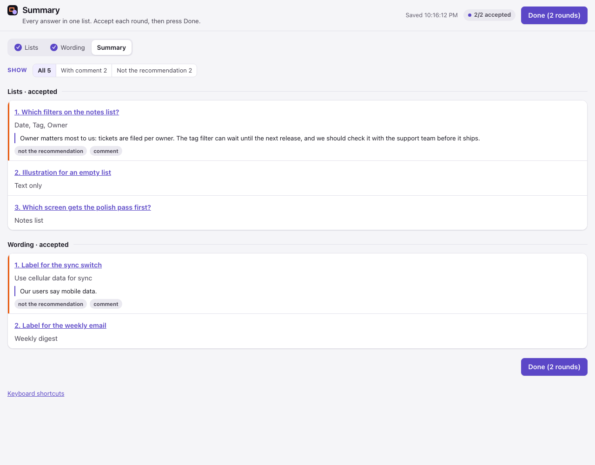
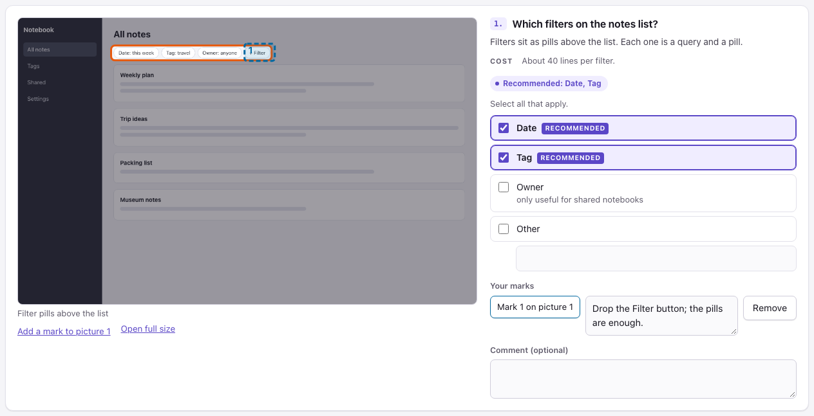
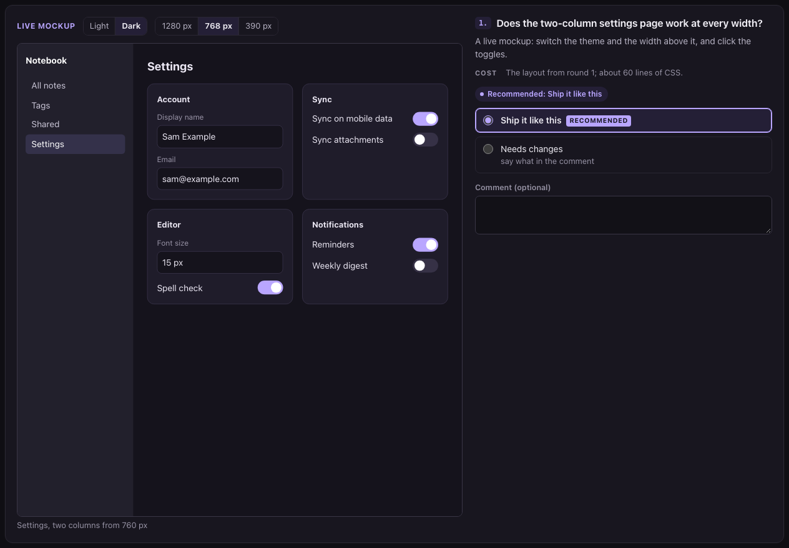
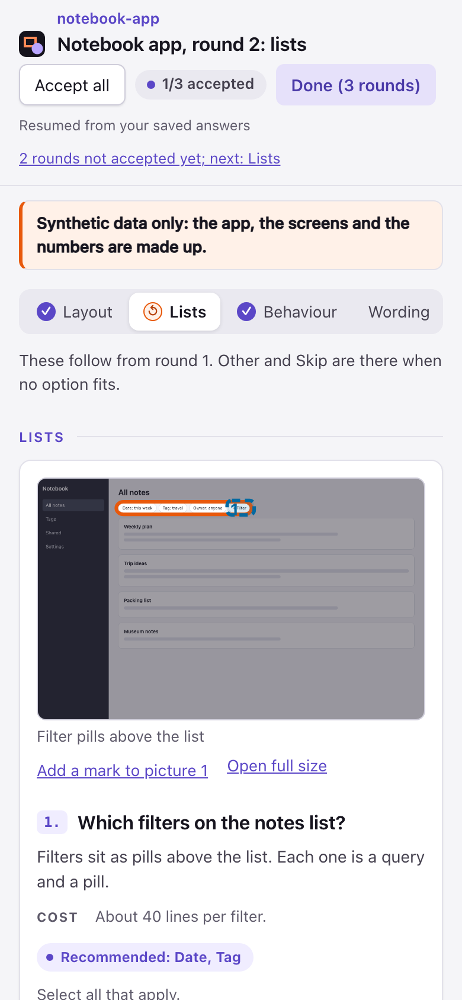

# On the page

<picture>
  <source media="(prefers-color-scheme: dark)" srcset="../media/page-dark.png">
  
</picture>

- **The project's name** and its two-letter monogram (the same as in the inbox) start the header, and the name
  starts the browser tab's title, so with several projects open you can tell which one is asking. It is the name
  of the nearest folder with a `.git`, or the parent of a `.signoff` folder, never the home folder and never a
  path. A decisions folder with neither shows no name. The past-decisions page shows the name of its root folder
  instead.
- **Rounds are in the sidebar**, each with its state in a word: open, accepted, changed, done. A round answered
  with Done in an earlier run is read only. A round that depends on earlier answers comes as a new run on the same
  folder, so the earlier ones stay in view. Under the rounds, the open round's items are listed; a click goes to
  one. The sidebar button hides the sidebar; in a narrow window it opens it as a drawer.
- **Pictures, boxes, costs.** Each item shows its question, its description and its pictures, with the relevant
  part boxed in orange and the rest dimmed, then the options and the comment. Click a picture to open it full
  size. When the options look different, the agent shows one picture per option, captioned with the option's
  name.
- **The recommendation is preselected** and labelled **Recommended**, and the margin beside the item says what
  the agent recommends (with the option's detail when it recommends one) and the cost under it (in a narrow window it sits between the
  question and the options). Change what you disagree with. **Accept all recommendations** in the header resets
  the open round to the recommendations, comments untouched; clicking it again undoes that, until you change an
  item's options.
- **Focus** (the button in the header, or `f`) shows one item at a time, with Previous and Next; the round's last
  box and its Accept or Done come after the last item. Esc leaves it. A phone opens the page in Focus.
- **Other and Skip** appear where the agent allows them: Other with its own text field, Skip on its own.
- **Cards or a table.** When the agent compares the options on criteria (effort, risk, the way back), each card
  shows its facts as small chips, and a **Cards / Table** toggle lays the options side by side, a row per
  criterion. Pick in either view: it is the same choice. The view itself is not saved. On a phone the table
  scrolls sideways in its own box, the criteria column staying in place.
- **Attachments.** Where an item lists text files (`.md` or `.txt`) the detail behind a choice shows under the
  options in a box that starts closed, as plain text. Nothing in it is rendered as Markdown or HTML.
- **Private** beside a comment marks what you write on that item as private: the agent is asked not to
  repeat it, and the Markdown copy and the Summary hide it. The agent ticks it in advance where an answer may
  hold personal data; you can tick or untick it on any item. It is a request to the agent, not encryption.
- **Everything saves as you go**; the key bar at the bottom shows when it last saved. The box at the end of each
  round takes anything the list did not ask.
- **Accept each round.** With more than one round open, **Accept this round** in the key bar (or Ctrl+Enter,
  Cmd+Enter on a Mac) accepts the open round and moves on to the next round not accepted yet. The header counts
  them, "2/3 accepted". Change anything in an accepted round, a comment included, and the sidebar shows it as
  changed until you accept it again.
- **The Summary** is the sign-off sheet: every answer of every round beside its question, flags where you
  departed from the recommendation, chose Other or Skip, drew marks or wrote a comment, and a link back to each
  item; Done sits under a rule at its end. A comment is quoted in its row, cut to three lines,
  with a **Full text** button for the rest. The filter above the list shows **All**, **With comment** or **Not the
  recommendation**, each with its count. A Private comment shows as "Private comment, hidden here.", with a
  "private" badge.
- **One round left open.** When only one round is still open, the same list sits above a second **Done** button at
  the end of that round, so you check your answers and finish in one click.
- **Done waits.** Until every open round is accepted, Done says which one is missing and takes you there; the
  server refuses an early Done too (409). Then Done closes every round at once and tells the agent. With a single
  round there is nothing to accept: Done does both.
- **A notice** from the agent, such as "Synthetic data only", shows as a banner under the header.

## Marks

Where the agent asks for it (`"marks": true`), you can point at things: drag a rectangle over the part of a
picture you mean, in blue so it stands apart from the agent's orange boxes, and write a comment for it. Without a
mouse, **Add a mark** puts one in the middle of the picture; on the mark's button the arrow keys move it and
Shift with the arrow keys resizes it. **Remove** deletes it.

## Live mockups (boards)

Instead of a picture, an item can show a board: the agent's own HTML page, running sandboxed, with switches for
light or dark and for a 1280, 768 or 390 pixel wide view, scaled to fit. Toggles and menus in it work; it cannot
read the Signoff page or save anything.

## Keyboard

The page works with the keyboard alone: Tab moves between fields, the arrow keys pick within a set of radio
buttons, Space ticks a checkbox. On top of that:

| Key | Does |
|---|---|
| `1` to `9` | picks that option in the current item (Other and Skip count last) |
| `j`, `k` | moves to the next or previous item |
| Up, Down, Home, End | on the rounds in the sidebar: switches rounds (Left and Right too) |
| arrow keys, Shift+arrow keys | on a mark: moves it, resizes it |
| Ctrl+Enter (Cmd+Enter on a Mac) | accepts the open round; with a single round, Done |
| `f` | Focus: one item at a time, with Previous and Next |
| Esc | leaves Focus, or closes the sidebar's drawer |
| Ctrl+, (Cmd+, on a Mac) | opens Appearance: the palette, light or dark, and the density |
| `?` | lists the shortcuts |

The shortcuts do nothing while you type in a text field or hold Ctrl, Alt or Cmd (Ctrl+Enter and Ctrl+, aside), so
typing, browser shortcuts and screen reader commands work as usual.

## Light, dark, phone, language

The page follows your system's light or dark setting, keeps WCAG AA contrast in both, and fits a phone screen.
Its colours are [Catppuccin](https://github.com/catppuccin/palette) (Latte in light, Mocha in dark). Five more
palettes are built in and tested for contrast (Signoff's own earlier colours, Rosé Pine, Gruvbox, Tokyo Night,
Dracula). To change them, press Cmd+, (Ctrl+, elsewhere; some browsers keep Cmd+, for their own settings) or the
brush button at the top right: the arrow keys show each palette, or System, Light and Dark, on the page behind
it, Enter keeps it and Esc goes back. It also switches between Comfortable and Compact: the inbox's rows and a
round's items, tighter.
In [the inbox](inbox.md#the-inbox) the choice is kept in `prefs.json` in the Signoff
home, and every Signoff page opens in it, a run's own page and Past decisions too. Without the inbox the picker
changes only the open tab, until you reload it. With your system's Increase contrast setting (or Windows' contrast
themes), the page uses a black and white high-contrast set instead. The palettes' credits are in
`THIRD_PARTY_NOTICES`.
Its own labels are in English, or in Hungarian when the decisions file's `lang` says `hu`; your content can be
in any language.

